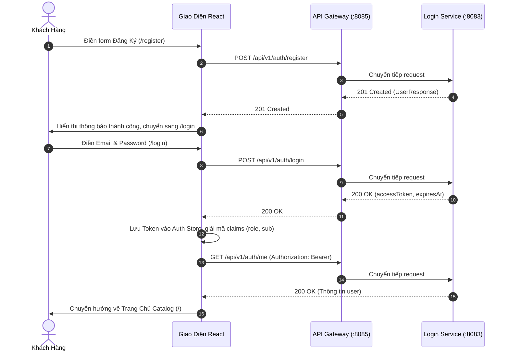
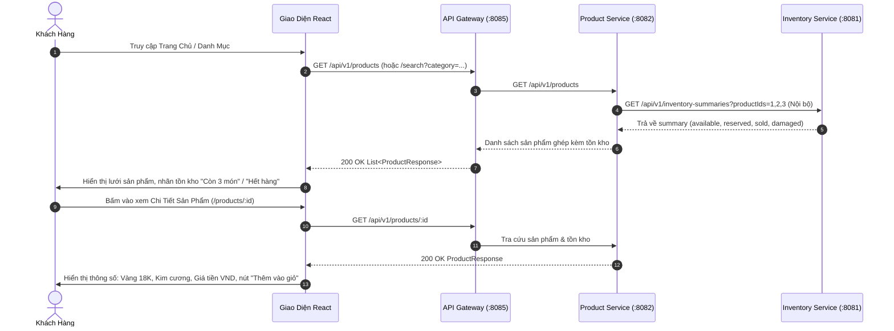
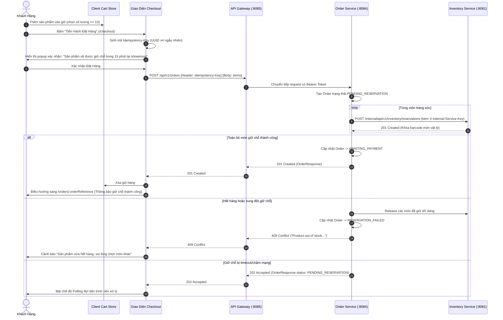
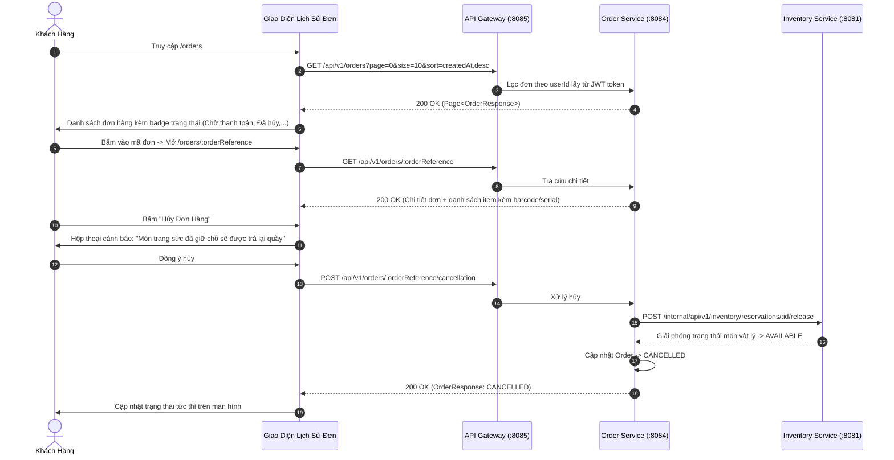

# 02. Hành Trình Người Dùng & Danh Mục Màn Hình Giao Diện (User Journeys & Screen Inventory)

> **Dự án**: JewelryShop Frontend Architecture  
> **Trạng thái**: Kế hoạch & Phân tích chi tiết (Planning Only)  
> **Ràng buộc nghiệp vụ tối cao**:  
> 1. Chỉ đưa vào các màn hình được chứng minh có API backend hỗ trợ.  
> 2. **Tuyệt đối không có luồng giao hàng / vận chuyển**. Mọi giao dịch nhận tại cửa hàng.  
> 3. Không đưa vào form thanh toán thẻ / ví điện tử vì backend chưa có API thanh toán.

---

## 1. Các Vai Trò Người Dùng Được Hệ Thống Hỗ Trợ (Supported Personas)

Dựa trên cấu hình phân quyền tại `api-gateway/SecurityConfig.java` và cơ sở dữ liệu `login-service`:

### 1.1. Khách Vãng Lai (Guest / Unauthenticated Visitor)
- **Đặc điểm**: Chưa có tài khoản hoặc chưa đăng nhập.
- **Quyền hạn kỹ thuật**: Chỉ được gọi các endpoint Public:
  - `POST /api/v1/auth/register` (Tạo tài khoản mới)
  - `POST /api/v1/auth/login` (Xác thực lấy JWT)
- **Rào cản kỹ thuật thực tế**: Gateway hiện đang chặn `GET /api/v1/products` đối với người dùng chưa có role `USER` hoặc `ADMIN`. Do đó, khách vãng lai khi truy cập trang web sẽ thấy banner/modal yêu cầu đăng nhập trước khi có thể duyệt xem catalog chi tiết.

### 1.2. Khách Hàng Đã Xác Thực (Authenticated Customer - `ROLE_USER`)
- **Đặc điểm**: Đã đăng nhập, sở hữu Bearer JWT hợp lệ với claim `roles: ["USER"]`.
- **Hành vi được hỗ trợ trọn vẹn**:
  - Tra cứu hồ sơ cá nhân (`GET /api/v1/auth/me`).
  - Xem danh mục sản phẩm, tìm kiếm theo thể loại, xem chi tiết sản phẩm kèm số lượng tồn kho khả dụng (`GET /api/v1/products/**`).
  - Quản lý giỏ hàng trên trình duyệt (Client-side Cart).
  - Đặt hàng & giữ chỗ món trang sức vật lý với khóa Idempotency Key (`POST /api/v1/orders`).
  - Xem danh sách lịch sử đơn hàng của chính mình (`GET /api/v1/orders?page=...`).
  - Xem chi tiết đơn hàng, danh sách mã món vật lý đã giữ chỗ (`GET /api/v1/orders/{orderReference}`).
  - Yêu cầu hủy đơn hàng để giải phóng các món giữ chỗ (`POST /api/v1/orders/{orderReference}/cancellation`).

### 1.3. Quản Trị Viên Cửa Hàng (Store Administrator - `ROLE_ADMIN`)
- **Đặc điểm**: Tài khoản quản trị, sở hữu Bearer JWT với claim `roles: ["ADMIN"]`.
- **Hành vi được hỗ trợ toàn diện**:
  - Toàn bộ các quyền hạn của `ROLE_USER`.
  - Quản trị danh mục sản phẩm: Tạo sản phẩm mới (`POST /api/v1/products`), cập nhật thông tin (`PUT /api/v1/products/{id}`), ngừng kinh doanh / soft delete (`DELETE /api/v1/products/{id}`).
  - Quản trị kho vật lý: Xem danh sách từng món trang sức (`GET /api/v1/inventory-items`), xem barcode, serial, trọng lượng vàng, độ tuổi vàng (`GET /api/v1/inventory-items/{id}`), đăng ký món trang sức mới vào kho (`POST /api/v1/inventory-items`).
  - Giám sát toàn bộ đơn hàng: Xem danh sách đơn của tất cả khách hàng, lọc theo trạng thái, can thiệp hủy đơn khi cần thiết.

---

## 2. Bản Đồ Hành Trình Người Dùng Chi Tiết (End-to-End User Journeys)

### Journey 1: Đăng Ký, Đăng Nhập & Bắt Đầu Phiên Làm Việc

### Journey 2: Khám Phá Sản Phẩm & Kiểm Tra Tồn Kho Vật Lý

### Journey 3: Đặt Hàng & Giữ Chỗ Món Trang Sức (Reservation Workflow)

### Journey 4: Tra Cứu Đơn Hàng & Hủy Đơn (Order Cancellation)

---

## 3. Danh Mục Màn Hình & Trạng Thái Giao Diện Toàn Diện (Screen Inventory & UI States)

### 3.1. Nhóm Màn Hình Xác Thực & Tài Khoản (Auth & Profile)

#### Màn hình `SCR-AUTH-01`: Đăng Nhập (`/login`)
- **API Liên Kết**: `POST /api/v1/auth/login`
- **Mô tả**: Cho phép người dùng nhập Email và Mật khẩu để lấy Bearer JWT.
- **Trạng thái chi tiết**:
  - `Loading`: Nút đăng nhập hiển thị spinner, disable toàn bộ input để ngăn double-submit.
  - `Validation Error`: Form validation bằng Zod (email đúng định dạng, password không để trống). Hiển thị text đỏ dưới từng input (`MUI HelperText`).
  - `API Error (401)`: Banner cảnh báo màu đỏ (`MUI Alert`): *"Email hoặc mật khẩu không chính xác, hoặc tài khoản đã bị vô hiệu hóa"*.
  - `Success`: Lưu token vào Storage, điều hướng về trang người dùng muốn truy cập trước đó (Return URL).

#### Màn hình `SCR-AUTH-02`: Đăng Ký Tài Khoản (`/register`)
- **API Liên Kết**: `POST /api/v1/auth/register`
- **Mô tả**: Đăng ký tài khoản khách hàng mới.
- **Ràng buộc đầu vào**:
  - `username`: 3 - 50 ký tự.
  - `email`: Định dạng email hợp lệ, tối đa 255 ký tự.
  - `password`: 6 - 72 ký tự (giới hạn tối đa theo chuẩn BCrypt).
- **Trạng thái chi tiết**:
  - `Validation Error`: Báo lỗi cụ thể dưới từng field khi vi phạm độ dài hoặc cấu trúc email.
  - `Conflict Error (409)`: Hiển thị thông báo lỗi từ backend: *"Tên đăng nhập hoặc email đã tồn tại trong hệ thống"*.
  - `Success (201)`: Hiển thị `Snackbar` thành công và tự động chuyển người dùng sang màn hình đăng nhập.

#### Màn hình `SCR-AUTH-03`: Hồ Sơ Người Dùng Hiện Tại (`/profile`)
- **API Liên Kết**: `GET /api/v1/auth/me`
- **Mô tả**: Xem thông tin tài khoản hiện tại, vai trò (User/Admin), ngày tạo.
- **Trạng thái chi tiết**:
  - `Loading`: `Skeleton` cho các trường thông tin.
  - `Success`: Hiển thị ID người dùng, Username, Email, Quyền hạn (`Chip` User/Admin), Trạng thái kích hoạt.
  - `Unauthorized (401)`: Tự động điều hướng ra `/login`.

---

### 3.2. Nhóm Màn Hình Khách Hàng & Mua Sắm (Customer Storefront)

#### Màn hình `SCR-STORE-01`: Danh Mục Sản Phẩm & Trang Chủ (`/`)
- **API Liên Kết**: `GET /api/v1/products`, `GET /api/v1/products/search?category=...`
- **Mô tả**: Trưng bày bộ sưu tập trang sức (Nhẫn, Dây chuyền, Bông tai, Vòng tay), lọc theo thể loại và hiển thị số lượng tồn kho khả dụng.
- **Trạng thái chi tiết**:
  - `Initial Loading`: Lưới thẻ sản phẩm hiển thị `Skeleton` hiệu ứng shimmer ánh sáng sang trọng.
  - `Success`: Danh sách các thẻ sản phẩm (Card) gồm tên, chất liệu (Vàng 18K, Bạc, Bạch kim), đá quý (Kim cương, Ruby), giá tiền (VND), và huy hiệu tồn kho (Ví dụ: *"Còn 2 chiếc tại quầy"*).
  - `Empty State`: Khi không tìm thấy sản phẩm nào theo bộ lọc, hiển thị hình minh họa trang sức tinh tế kèm lời nhắn: *"Không tìm thấy món trang sức phù hợp với tiêu chí lọc"*.
  - `Downstream Error (503)`: Nếu Inventory Service gặp sự cố, backend ném 503. UI hiển thị thông báo thân thiện: *"Dịch vụ kiểm tra tồn kho đang bảo trì. Vui lòng thử lại sau giây lát"*.
  - `Unauthorized (401/403)`: Vì Gateway đang chặn người dùng ẩn danh xem sản phẩm, màn hình hiển thị lời chào sang trọng yêu cầu đăng nhập: *"Đăng nhập để chiêm ngưỡng bộ sưu tập trang sức cao cấp"*.

#### Màn hình `SCR-STORE-02`: Chi Tiết Món Trang Sức (`/products/:id`)
- **API Liên Kết**: `GET /api/v1/products/{id}`
- **Mô tả**: Xem thông số kỹ thuật chi tiết của món trang sức.
- **Trạng thái chi tiết**:
  - `Loading`: `Skeleton` lớn cho hình ảnh placeholder và khối thông số.
  - `Success`:
    - Tên sản phẩm, mã danh mục.
    - Bảng thông số: Chất liệu (`material`), Loại đá quý (`gemstone`), Giá niêm yết VND (`price`).
    - Mô tả nguồn gốc chế tác (`description`).
    - Trạng thái kho vật lý: Hiển thị số lượng có sẵn (`availableQuantity`). Nếu `availableQuantity <= 0` hoặc `active = false`, nút "Thêm vào giỏ" bị mờ (disabled) với nhãn *"Tạm hết hàng tại quầy"*.
  - `Not Found (404)`: Banner thông báo *"Món trang sức này không tồn tại hoặc đã ngừng kinh doanh"*.

#### Màn hình `SCR-STORE-03`: Giỏ Hàng Mua Sắm (`/cart` hoặc Drawer Giỏ Hàng)
- **API Liên Kết**: **Client-side State (LocalStorage)** (Backend không có API Cart).
- **Mô tả**: Quản lý các món trang sức người dùng muốn mua trước khi tạo đơn.
- **Quy tắc giỏ hàng**:
  - Cho phép tăng/giảm số lượng từ 1 đến 10 cho mỗi món (tuân thủ validation `OrderItemRequest.quantity <= 10`).
  - Tổng số lượng sản phẩm vật lý trong toàn bộ giỏ không được vượt quá 20 (tuân thủ ràng buộc `maxItemsPerOrder = 20` của Order Service).
- **Trạng thái chi tiết**:
  - `Empty State`: *"Giỏ hàng của bạn đang trống. Hãy khám phá những tuyệt tác trang sức của chúng tôi"*. Nút bấm dẫn về Catalog.
  - `Limit Warning`: Khi người dùng thêm quá 10 món cho 1 sản phẩm hoặc tổng quá 20 món, hiển thị cảnh báo giới hạn đặt hàng trực tiếp trong giỏ.
  - `CTA Action`: Nút bấm "Tiến hành Đặt hàng & Giữ chỗ" kích hoạt điều hướng sang `/checkout`.

#### Màn hình `SCR-STORE-04`: Xác Nhận Đặt Hàng & Giữ Chỗ (`/checkout`)
- **API Liên Kết**: `POST /api/v1/orders` [Header: `Idempotency-Key: UUID`]
- **Ràng buộc nghiệp vụ**:
  - Không có trường nhập địa chỉ giao hàng.
  - Màn hình thông báo rõ: *"Món trang sức sẽ được giữ chỗ trực tiếp tại showroom trong vòng 15 phút để bạn đến trải nghiệm và thanh toán."*
- **Trạng thái chi tiết**:
  - `Submitting`: Nút bấm khóa lại, hiển thị hiệu ứng xoay tròn và nhãn *"Đang gửi yêu cầu giữ chỗ vật lý..."*.
  - `Success (201 Created)`: Điều hướng ngay sang màn hình chi tiết đơn hàng `/orders/:orderReference` với thông báo *"Giữ chỗ thành công. Mã đơn hàng của bạn là [orderReference]"*.
  - `Pending (202 Accepted)`: Hiển thị thông báo *"Đơn hàng đang chờ đồng bộ giữ chỗ với kho. Hệ thống đang tự động xác nhận..."* kèm cơ chế kiểm tra định kỳ (Polling).
  - `Conflict (409)`: Hiển thị thông báo lỗi chi tiết khi món hàng vừa bị khách khác giữ mất hoặc khóa trùng lặp.
  - `Service Unavailable (503)`: Báo lỗi kết nối dịch vụ tồn kho, hướng dẫn khách hàng liên hệ hotline showroom.

#### Màn hình `SCR-STORE-05`: Lịch Sử Đơn Hàng Của Khách Hàng (`/orders`)
- **API Liên Kết**: `GET /api/v1/orders?page=...&size=...&sort=createdAt,desc&status=...`
- **Mô tả**: Xem danh sách các đơn hàng của tài khoản đang đăng nhập.
- **Trạng thái chi tiết**:
  - `Loading`: Danh sách Skeleton đơn hàng.
  - `Success`: Bảng/Thẻ danh sách đơn với Mã đơn (`orderReference`), Ngày tạo, Tổng tiền VND (`totalAmount`), Huy hiệu trạng thái:
    - `AWAITING_PAYMENT`: Màu vàng đồng/amber ("Chờ thanh toán & nhận hàng").
    - `CONFIRMED`: Màu xanh lá ("Đã hoàn tất thanh toán").
    - `CANCELLED`: Màu xám ("Đã hủy / Đã giải phóng giữ chỗ").
    - `PENDING_RESERVATION`: Màu xanh dương ("Đang xử lý giữ chỗ").
  - `Empty State`: *"Bạn chưa có đơn đặt hàng nào"*.

#### Màn hình `SCR-STORE-06`: Chi Tiết Đơn Hàng & Hủy Đơn (`/orders/:orderReference`)
- **API Liên Kết**: `GET /api/v1/orders/{orderReference}`, `POST /api/v1/orders/{orderReference}/cancellation`
- **Mô tả**: Xem thông tin chi tiết từng món đồ vật lý được giữ chỗ trong đơn, và cho phép khách hủy đơn nếu không còn nhu cầu.
- **Trạng thái chi tiết**:
  - `Success`:
    - Danh sách từng món: Tên trang sức, Đơn giá lúc đặt, Mã món giữ chỗ (`orderItemReference`), Trạng thái món (`RESERVED`, `COMMITTED`, `RELEASED`).
    - Nút "Hủy đơn hàng": Chỉ hiển thị khi đơn ở trạng thái `AWAITING_PAYMENT` hoặc `PENDING_RESERVATION`.
  - `Cancellation Modal`: Dialog xác nhận hỏi khách hàng có chắc chắn muốn hủy đơn và giải phóng giữ chỗ cho người khác hay không.
  - `Cancellation In-Progress`: Nút hủy hiển thị spinner.
  - `Cancellation Done`: Cập nhật trạng thái tức thời sang `CANCELLED`.

---

### 3.3. Nhóm Màn Hình Quản Trị Viên (Admin Management)

#### Màn hình `SCR-ADM-01`: Quản Lý Danh Mục Trang Sức (`/admin/products`)
- **API Liên Kết**: `GET /api/v1/products`, `POST /api/v1/products`, `PUT /api/v1/products/{id}`, `DELETE /api/v1/products/{id}`
- **Quyền hạn**: Bắt buộc `ROLE_ADMIN` (nếu User thường truy cập sẽ bị 403 Forbidden).
- **Tính năng**:
  - Bảng dữ liệu sản phẩm kèm bộ lọc trạng thái (Active/Inactive).
  - Modal "Thêm mới sản phẩm": Form nhập Tên, Thể loại, Chất liệu, Đá quý, Giá bán VND, Mô tả.
  - Modal "Sửa thông tin sản phẩm": Chỉnh sửa thông tin và bật/tắt cờ `active`.
  - Thao tác "Ngừng kinh doanh": Gọi `DELETE /api/v1/products/{id}` để soft delete.

#### Màn hình `SCR-ADM-02`: Quản Lý Kho Món Đồ Vật Lý (`/admin/inventory`)
- **API Liên Kết**: `GET /api/v1/inventory-items`, `GET /api/v1/inventory-items/{id}`, `POST /api/v1/inventory-items`
- **Quyền hạn**: Bắt buộc `ROLE_ADMIN`.
- **Tính năng**:
  - Bảng tra cứu từng món đồ vật lý độc bản: Barcode, Serial Number, Trọng lượng thực tế (`actualWeightGrams`), Độ tinh khiết vàng (`actualGoldPurityPercent` ví dụ 99.99%), Mã kiểm định (`certificateNumber`), Vị trí khay đựng (`locationCode`), Trạng thái vật lý (`AVAILABLE`, `RESERVED`, `SOLD`, `DAMAGED`).
  - Modal "Đăng ký món vật lý mới": Điền thông số chi tiết của món vàng/kim cương mới nhập về quầy.

#### Màn hình `SCR-ADM-03`: Giám Sát Đơn Hàng Toàn Hệ Thống (`/admin/orders`)
- **API Liên Kết**: `GET /api/v1/orders`, `POST /api/v1/orders/{orderReference}/cancellation`
- **Quyền hạn**: Bắt buộc `ROLE_ADMIN`.
- **Tính năng**:
  - Xem tất cả đơn hàng của mọi người dùng với bộ lọc trạng thái và phân trang.
  - Xem ID người dùng đặt hàng (`userId`).
  - Hủy đơn thay cho khách nếu quá hạn đến quầy thanh toán.

---

## 4. Các Màn Hình Bị Loại Bỏ Hoặc Đang Bị Chặn Do Thiếu API (Excluded & Blocked Screens)

| Màn Hình Đề Xuất Phổ Biến | Trạng Thái Trong Dự Án | Lý Do Kỹ Thuật & Căn Cứ Từ Mã Nguồn |
| :--- | :--- | :--- |
| **Màn hình Nhập địa chỉ & Theo dõi giao hàng** | **LOẠI BỎ TRIỆT ĐỂ (EXCLUDED)** | Tuân thủ nguyên tắc kinh doanh tối cao: JewelryShop không có luồng shipping/delivery. Không có bảng `shipping_addresses` hay đối tác vận chuyển. Khách nhận hàng tại tiệm. |
| **Màn hình Cổng thanh toán (VNPAY / Momo / Credit Card)** | **BỊ CHẶN DO THIẾU API (BLOCKED)** | Backend chưa xây dựng module thanh toán. Trạng thái đơn dừng lại ở `AWAITING_PAYMENT`. Không được dựng form nhập thẻ giả lập. |
| **Màn hình Đánh giá & Bình luận (Reviews & Ratings)** | **BỊ CHẶN DO THIẾU API (BLOCKED)** | Không có bảng `reviews`, `ratings` hay bất kỳ controller nào hỗ trợ gửi feedback sản phẩm. |
| **Màn hình Danh sách yêu thích (Wishlist)** | **BỊ CHẶN DO THIẾU API (BLOCKED)** | Không có API quản lý wishlist trên server. Nếu làm ở client thì không đồng bộ giữa các thiết bị. |
| **Màn hình Tải ảnh sản phẩm lên kho (Image Upload)** | **BỊ CHẶN DO THIẾU API (BLOCKED)** | Thực thể `Product.java` hoàn toàn không có cột lưu đường dẫn ảnh (`imageUrl`). Không có API tải tệp đa phương tiện. |
| **Màn hình Chỉnh sửa hồ sơ cá nhân / Đổi mật khẩu** | **BỊ CHẶN DO THIẾU API (BLOCKED)** | `login-service` chỉ có endpoint đọc `GET /api/v1/auth/me`. Không có API cập nhật thông tin người dùng hay đổi mật khẩu. |

---

## 5. Tiêu Chuẩn Trải Nghiệm Trên Thiết Bị Di Động & Tiếp Cận (Mobile & Accessibility)

1. **Vùng Chạm (Touch Targets)**: Mọi nút bấm, icon button, menu toggle đều có kích thước tối thiểu **44x44px** (theo chuẩn iOS Human Interface Guidelines và WCAG 2.5.5).
2. **Quản Lý Tiêu Điểm Bàn Phím (Focus Management)**:
   - Khi mở Modal xác nhận đặt hàng hoặc Modal hủy đơn, tiêu điểm (focus) tự động di chuyển vào modal và bị giữ trong modal (Focus Trap).
   - Phím `Escape` đóng modal tức thì.
   - Khi đóng modal, tiêu điểm được trả lại chính xác nút kích hoạt trước đó.
3. **Vùng Cập Nhật Động (ARIA Live Regions)**:
   - Số lượng sản phẩm trên icon Giỏ hàng dùng `aria-live="polite"`.
   - Tiến trình giữ chỗ đơn hàng khi trả về `202 Accepted` dùng thông báo `aria-live="assertive"` để trình đọc màn hình thông báo kịp thời.
4. **Độ Tương Phản Màu Sắc**: Toàn bộ chữ hiển thị trên nền tối hoặc nền sáng đều đảm bảo tỷ lệ tương phản tối thiểu **4.5:1** đối với văn bản thông thường và **3:1** đối với văn bản lớn / biểu tượng chức năng.

