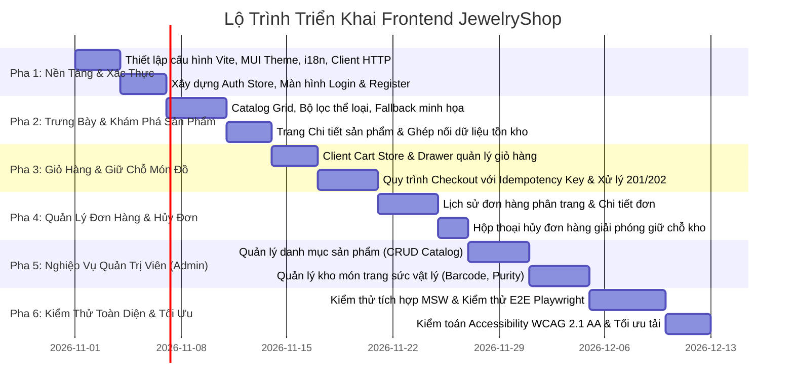

# 05. Lộ Trình Triển Khai Thực Hiện (Implementation Roadmap)

> **Dự án**: JewelryShop Frontend Development  
> **Trạng thái**: Kế hoạch lộ trình (Planning Only - Chưa triển khai mã nguồn)  
> **Nguyên tắc sắp xếp**: Ưu tiên theo giá trị người dùng xuyên suốt (End-to-End User Value) và mức độ sẵn sàng thực tế của Backend APIs.

---

## 1. Tổng Quan Các Pha Triển Khai (Roadmap Overview)

---

## 2. Kế Hoạch Chi Tiết Từng Pha (Detailed Phased Plan)

### PHA 1: Thiết Lập Nền Tảng, Giao Tiếp Gateway & Xác Thực Người Dùng (Foundation & Auth)
- **Mục tiêu**: Xây dựng bộ khung ứng dụng, kết nối thành công với API Gateway qua Vite Proxy, hoàn thiện luồng Đăng ký / Đăng nhập / Xem thông tin cá nhân.
- **Tiền đề (Prerequisites)**:
  - API Gateway (`:8085`) và Login Service (`:8083`) đang chạy bình thường.
  - Tệp khóa công khai RSA `public_key.pem` hợp lệ tại `login-service/keys/`.
- **Tệp dự kiến tạo**:
  - `src/api/client.ts`, `src/api/endpoints.ts`, `src/api/errorHandler.ts`
  - `src/theme/index.ts`, `src/theme/palette.ts`, `src/theme/typography.ts`, `src/theme/components.ts`
  - `src/i18n/config.ts`, `src/i18n/locales/vi/common.json`, `src/i18n/locales/en/common.json`
  - `src/features/auth/store/authStore.ts`, `src/features/auth/api/useAuth.ts`
  - `src/features/auth/components/LoginForm.tsx`, `src/features/auth/components/RegisterForm.tsx`
  - `src/components/guards/ProtectedRoute.tsx`, `src/components/guards/RoleGuard.tsx`
  - `src/routes/index.tsx`, `src/layouts/RootLayout.tsx`
- **Kịch bản kiểm thử cần đạt (Tests)**:
  - Unit test cho `authStore`: Đảm bảo lưu đúng token và giải mã claims (`sub`, `roles`).
  - Unit test cho `RegisterForm` và `LoginForm`: Kiểm tra Zod validation ngăn submit dữ liệu rỗng.
  - Component test: Kiểm tra thông báo lỗi 401 khi sai mật khẩu, thông báo 409 khi trùng email.
- **Tiêu chuẩn hoàn thành (Definition of Done - DoD)**:
  - Người dùng có thể đăng ký tài khoản mới và đăng nhập thành công.
  - Token được tự động gắn vào Header `Authorization: Bearer` của mọi request tiếp theo.
  - Khi token hết hạn (sau 15 phút), hệ thống tự động đăng xuất và điều hướng an toàn về `/login`.

---

### PHA 2: Trưng Bày Danh Mục & Khám Phá Món Trang Sức (Catalog & Product Discovery)
- **Mục tiêu**: Cho phép khách hàng duyệt xem bộ sưu tập trang sức, lọc theo danh mục, xem chi tiết món đồ kèm thông tin tồn kho trực tiếp từ Inventory Service.
- **Tiền đề**: Pha 1 hoàn thành; Product Service (`:8082`) và Inventory Service (`:8081`) đang hoạt động.
- **Tệp dự kiến tạo**:
  - `src/features/catalog/api/useProductsQuery.ts`, `src/features/catalog/api/useProductDetailQuery.ts`
  - `src/features/catalog/components/ProductCard.tsx`, `src/features/catalog/components/ProductGrid.tsx`
  - `src/features/catalog/components/CategoryFilter.tsx`, `src/features/catalog/components/JewelryIllustration.tsx`
  - `src/features/catalog/pages/CatalogPage.tsx`, `src/features/catalog/pages/ProductDetailPage.tsx`
- **Kịch bản kiểm thử cần đạt (Tests)**:
  - Test hiển thị nhãn tồn kho: `availableQuantity > 0` hiển thị màu xanh, `availableQuantity == 0` hiển thị hết hàng, `inventory == null` hiển thị đang cập nhật (lỗi 503).
  - Test lọc danh mục qua URL Search Params (`?category=Rings`).
- **Tiêu chuẩn hoàn thành (DoD)**:
  - Lưới sản phẩm responsive mượt mà từ Mobile (1 cột) đến Desktop (3-4 cột).
  - Khối vector minh họa hiển thị đúng biểu tượng nhẫn, dây chuyền, bông tai theo thể loại.
  - Nút "Thêm vào giỏ" tự động disabled khi sản phẩm hết hàng hoặc `active = false`.

---

### PHA 3: Giỏ Hàng Trình Duyệt & Quy Trình Giữ Chỗ Món Đồ (Cart & Reservation Workflow)
- **Mục tiêu**: Xây dựng giỏ hàng lưu trữ trên máy khách (LocalStorage) và hoàn tất quy trình đặt hàng tạo giữ chỗ vật lý qua Order Service.
- **Tiền đề**: Pha 2 hoàn thành; Order Service (`:8084`) đang hoạt động.
- **Tệp dự kiến tạo**:
  - `src/features/cart/store/cartStore.ts`
  - `src/features/cart/components/CartDrawer.tsx`, `src/features/cart/components/CartItemRow.tsx`
  - `src/features/orders/api/useCreateOrderMutation.ts`
  - `src/features/orders/components/CheckoutModal.tsx`
  - `src/features/orders/utils/generateIdempotencyKey.ts`
- **Kịch bản kiểm thử cần đạt (Tests)**:
  - Test giới hạn giỏ hàng: Chặn thêm quá 10 cái cho 1 món; chặn tổng số lượng vượt quá 20 cái.
  - Test mutation đặt hàng: Sinh đúng UUID v4 làm `Idempotency-Key`.
  - Test xử lý mã phản hồi: Điều hướng thành công khi nhận `201 Created`, bật polling khi nhận `202 Accepted`, hiển thị alert khi nhận `409 Conflict`.
- **Tiêu chuẩn hoàn thành (DoD)**:
  - Giỏ hàng lưu trữ bền vững qua F5.
  - Quy trình đặt hàng thông báo rõ cam kết giữ chỗ tại showroom trong 15 phút, không đòi hỏi địa chỉ giao hàng.
  - Sau khi đặt hàng thành công, giỏ hàng tự động được xóa sạch.

---

### PHA 4: Quản Lý Đơn Hàng & Hủy Đơn Giải Phóng Tồn Kho (Order Management & Cancellation)
- **Mục tiêu**: Cho phép khách hàng theo dõi danh sách các đơn đã đặt, xem chi tiết từng món đồ vật lý được giữ chỗ, và chủ động hủy đơn nếu không còn nhu cầu.
- **Tiền đề**: Pha 3 hoàn thành.
- **Tệp dự kiến tạo**:
  - `src/features/orders/api/useOrdersQuery.ts`, `src/features/orders/api/useOrderDetailQuery.ts`
  - `src/features/orders/api/useCancelOrderMutation.ts`
  - `src/features/orders/components/OrderListTable.tsx`, `src/features/orders/components/OrderDetailCard.tsx`
  - `src/features/orders/components/CancelOrderDialog.tsx`
  - `src/features/orders/pages/OrderListPage.tsx`, `src/features/orders/pages/OrderDetailPage.tsx`
- **Kịch bản kiểm thử cần đạt (Tests)**:
  - Test phân trang danh sách đơn hàng (`page`, `size`, `sort`).
  - Test logic hiển thị nút hủy: Chỉ cho phép hủy khi trạng thái là `AWAITING_PAYMENT` hoặc `PENDING_RESERVATION`.
  - Test xác nhận hủy: Hộp thoại cảnh báo mở ra, gọi API `POST .../cancellation`, cập nhật UI tức thì sang `CANCELLED`.
- **Tiêu chuẩn hoàn thành (DoD)**:
  - Khách hàng xem được mã tham chiếu món vật lý (`orderItemReference`) trong đơn hàng.
  - Thao tác hủy đơn diễn ra mượt mà, giải phóng tồn kho vật lý phía backend mà không gây lỗi giao diện.

---

### PHA 5: Nghiệp Vụ Bảng Điều Khiển Quản Trị Viên (Admin Operations)
- **Mục tiêu**: Cung cấp giao diện quản trị chuyên biệt cho `ROLE_ADMIN` để quản lý danh mục sản phẩm và tra cứu/đăng ký các món trang sức vật lý trong kho.
- **Tiền đề**: Pha 4 hoàn thành; tài khoản thử nghiệm có role `ADMIN`.
- **Tệp dự kiến tạo**:
  - `src/layouts/AdminLayout.tsx`
  - `src/features/catalog/components/AdminProductTable.tsx`, `src/features/catalog/components/ProductFormModal.tsx`
  - `src/features/inventory/api/useInventoryItemsQuery.ts`, `src/features/inventory/api/useCreateInventoryItemMutation.ts`
  - `src/features/inventory/components/InventoryTable.tsx`, `src/features/inventory/components/CreateInventoryItemModal.tsx`
  - `src/features/inventory/pages/AdminInventoryPage.tsx`
  - `src/features/orders/pages/AdminOrderOversightPage.tsx`
- **Kịch bản kiểm thử cần đạt (Tests)**:
  - Test bảo vệ route: Người dùng có role `USER` khi cố truy cập `/admin/*` sẽ bị chặn với màn hình `403 Forbidden`.
  - Test tạo sản phẩm mới: Kiểm tra form validation và hiển thị trong danh mục.
  - Test đăng ký món vật lý: Nhập mã barcode, trọng lượng gram, độ tuổi vàng và kiểm tra hiển thị trên bảng kho.
- **Tiêu chuẩn hoàn thành (DoD)**:
  - Quản trị viên có thể thêm, sửa, soft-delete sản phẩm.
  - Quản trị viên tra cứu được barcode, mã kiểm định đá quý của từng món vật lý.
  - Quản trị viên xem được đơn hàng của toàn bộ khách hàng trong hệ thống.

---

### PHA 6: Tối Ưu Trải Nghiệm, Kiểm Toán Tiếp Cận (WCAG) & Kiểm Thử E2E (Polish & Verification)
- **Mục tiêu**: Hoàn thiện toàn diện các chỉ số tiếp cận (Accessibility), kiểm tra trên đa kích thước màn hình và tự động hóa kiểm thử luồng người dùng bằng Playwright.
- **Tiền đề**: Toàn bộ 5 pha trên đã hoàn thành.
- **Kịch bản kiểm thử cần đạt (Tests)**:
  - Playwright E2E Suite: Khách hàng đăng ký -> Đăng nhập -> Chọn nhẫn kim cương -> Đặt hàng -> Kiểm tra mã đơn -> Hủy đơn.
  - Playwright E2E Suite: Admin đăng nhập -> Đăng ký món vật lý mới -> Kiểm tra số lượng tồn kho của sản phẩm tăng thêm 1.
  - Kiểm toán Axe Accessibility: Đạt 0 lỗi vi phạm WCAG 2.1 Level AA (tương phản màu, nhãn aria, focus trap).
- **Tiêu chuẩn hoàn thành (DoD)**:
  - Điểm Google Lighthouse Accessibility đạt trên 95.
  - 100% các nút bấm đạt diện tích chạm >= 44x44px trên thiết bị di động.
  - Bộ kiểm thử E2E chạy ổn định, không có flaky tests.

