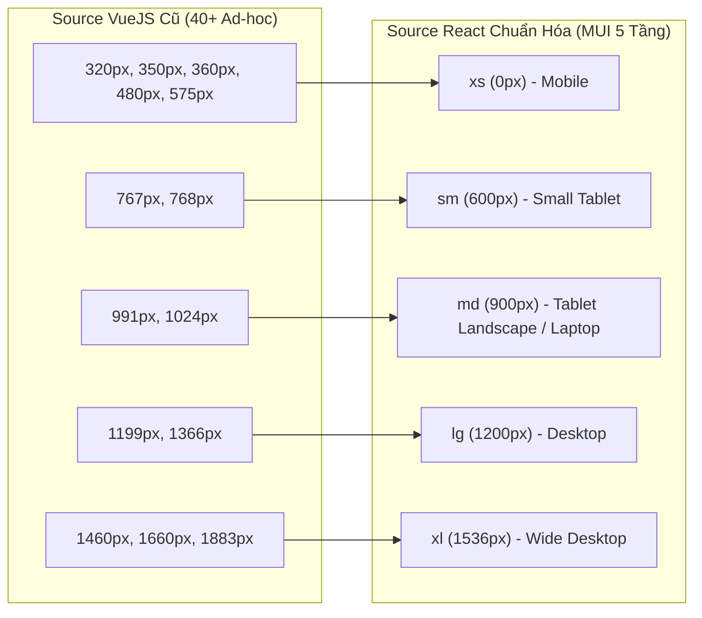

# BỘ TIÊU CHUẨN RESPONSIVE DESIGN SYSTEM DÀNH CHO DỰ ÁN REACT (MUI v9)

> **Mã tài liệu:** `RDS-REACT-02`  
> **Dự án áp dụng:** `SOURCE_REACT` (`D:\java\JewelryShop_FE\jewelryshop-frontend`)  
> **Công nghệ nền tảng:** React 19, TypeScript, Material UI 9 (`@mui/material`), Emotion, Vite  
> **Nguyên tắc cốt lõi:** Chắt lọc tinh hoa từ kết quả Reverse Engineering source VueJS cũ, loại bỏ 40+ breakpoint hỗn loạn, chuẩn hóa toàn diện trên kiến trúc Mobile-First và Design Tokens của Material UI.

---

## 1. Chiến lược Breakpoints (Breakpoint Strategy)

### 1.1. Chuyển đổi từ Desktop-First (VueJS) sang Mobile-First (React)
- **Source VueJS cũ:** Sử dụng chủ yếu `@media (max-width: ...)` để ghi đè (override) từ desktop xuống mobile, dẫn đến 14,000 dòng CSS đầy xung đột và hàng loạt khai báo `!important`.
- **Hệ thống React mới:** Áp dụng **100% Mobile-First** với `@media (min-width: ...)` thông qua cú pháp responsive đối tượng của MUI (`sx={{ prop: { xs: ..., sm: ..., md: ..., lg: ... } }}`).
  - Thiết kế mặc định áp dụng cho Mobile nhỏ nhất.
  - Các màn hình lớn hơn chỉ bổ sung các thuộc tính mở rộng không gian.

### 1.2. Bảng quy chuẩn Breakpoints MUI 5 cấp độ

| Tên mã | Viewport Range | Kích thước min-width | Nhóm thiết bị mục tiêu | Vai trò trong Layout |
|---|---|---|---|---|
| `xs` | $0\text{px} - 599\text{px}$ | $0\text{px}$ | Điện thoại thông minh (iPhone SE, 13/14/15, Samsung Galaxy, Pixel) | Layout 1 cột (hoặc 2 cột cho card nhỏ), Header dạng Drawer, Modal full-screen |
| `sm` | $600\text{px} - 899\text{px}$ | $600\text{px}$ | Máy tính bảng dọc (iPad Mini, tablet 7-8"), điện thoại màn hình gập mở rộng | Grid 2 cột, form nhập liệu 2 cột, dialog có margin đệm |
| `md` | $900\text{px} - 1199\text{px}$ | $900\text{px}$ | Máy tính bảng ngang (iPad 10.2", Air, Pro dọc), laptop nhỏ 11" | **Điểm bẻ gãy chính:** Header chuyển sang Desktop Nav ngang, Grid 3 cột |
| `lg` | $1200\text{px} - 1535\text{px}$ | $1200\text{px}$ | Màn hình máy tính xách tay chuẩn (13-15"), màn hình desktop văn phòng | Layout 4 cột tiêu chuẩn, hiển thị đầy đủ thông số kỹ thuật và sidebars |
| `xl` | $\ge 1536\text{px}$ | $1536\text{px}$ | Màn hình máy tính để bàn lớn (24-32", Full HD, 2K, 4K) | Giới hạn container tối đa, tăng padding thoáng đãng, tối ưu không gian hiển thị |

### 1.3. Ánh xạ từ các Breakpoints cũ của Vue sang React



---

## 2. Hệ thống Khung chứa (Container System)

### 2.1. Chuẩn hóa Max-Width và Gutters
Để kế thừa độ rộng hiển thị sang trọng của trang thương mại điện tử / kim hoàn từ template cũ mà không phá vỡ tính nhất quán của MUI:
- Thay vì cưỡng chế `.container { max-width: 1400px; }` bằng CSS thô ở `min-width: 1461px` như Vue, React sử dụng component `<Container>` của MUI:

```typescript
// Định nghĩa container tiêu chuẩn cho toàn bộ Storefront Pages
<Container
  maxWidth="xl"
  sx={{
    px: { xs: 2, sm: 3, md: 4, lg: 5 }, // Gutters co giãn tương ứng 16px -> 24px -> 32px -> 40px
    maxWidth: { xl: '1440px' },         // Khống chế bề rộng tối đa tương thích với thiết kế cao cấp
  }}
>
  {children}
</Container>
```

### 2.2. Phân loại Khung chứa (Container Variants)

| Phân loại | Component / Cấu hình | Viewport Max-width | Trường hợp sử dụng |
|---|---|---|---|
| **Standard Storefront** | `<Container maxWidth="lg">` | $1200\text{px}$ | Chi tiết sản phẩm, giỏ hàng, thanh toán, đơn hàng |
| **Catalog & Showcase** | `<Container maxWidth="xl">` | $1440\text{px}$ | Trang danh mục sản phẩm chính, bộ sưu tập kim hoàn |
| **Full-bleed Hero / Banner** | `<Box sx={{ width: '100%', px: 0 }}>` | $100\text{vw}$ | Banner chính, Video background, Dải cam kết thương hiệu |
| **Constrained Form** | `<Container maxWidth="sm">` | $600\text{px}$ | Form đăng nhập, đăng ký, modal xác nhận thanh toán |

---

## 3. Hệ thống Khoảng cách (Spacing System: 8-Point Grid)

Dự án áp dụng chặt chẽ thang đo 8-point grid tiêu chuẩn thông qua hàm `theme.spacing()` của MUI:

| Index MUI | Giá trị px | Ký hiệu rem | Ứng dụng cụ thể trong giao diện |
|---|---|---|---|
| `0.5` | $4\text{px}$ | $0.25\text{rem}$ | Khoảng cách giữa icon và nhãn văn bản nhỏ, border-radius nhỏ |
| `1` | $8\text{px}$ | $0.5\text{rem}$ | Gap giữa các tag/chips, khoảng cách nội bộ trong badge |
| `1.5` | $12\text{px}$ | $0.75\text{rem}$ | Padding nút nhỏ, khoảng cách avatar và tên người dùng |
| `2` | $16\text{px}$ | $1.0\text{rem}$ | Padding viền màn hình mobile (`xs`), gap giữa các card trên mobile |
| `3` | $24\text{px}$ | $1.5\text{rem}$ | Padding thẻ card sản phẩm, margin-bottom của tiêu đề phụ |
| `4` | $32\text{px}$ | $2.0\text{rem}$ | Gap giữa các cột grid trên tablet/desktop, padding dọc section nhỏ |
| `6` | $48\text{px}$ | $3.0\text{rem}$ | Khoảng cách giữa các khối nội dung lớn trên mobile |
| `8` | $64\text{px}$ | $4.0\text{rem}$ | Padding dọc tiêu chuẩn cho các section trên tablet |
| `10` | $80\text{px}$ | $5.0\text{rem}$ | Padding dọc cho các hero section trên desktop |

### Quy tắc Section Spacing thích ứng theo Viewport
```typescript
export const sectionSpacing = {
  py: { xs: 5, sm: 7, md: 10 }, // 40px trên mobile -> 56px trên tablet -> 80px trên desktop
}
```

---

## 4. Hệ thống Chữ thích ứng (Fluid Typography System)

### 4.1. Kế thừa và Hiện đại hóa Công thức Fluid Typography
Trong source Vue cũ, công thức CSS lock:
$$\text{font-size} = \text{calc}\left(26\text{px} + (55 - 26) \times \frac{100\text{vw} - 320\text{px}}{1920 - 320}\right)$$
Trong source React, công thức này được hiện đại hóa bằng hàm chuẩn CSS `clamp(min, preferred, max)` trong file [src/theme/typography.ts](file:///D:/java/JewelryShop_FE/jewelryshop-frontend/src/theme/typography.ts):

```typescript
export const typographyOptions: TypographyVariantsOptions = {
  fontFamily: '"DM Sans", Arial, sans-serif',
  
  // H1: Banner chính, Hero - co giãn tự động từ 36px đến 56px
  h1: {
    fontFamily: '"Playfair Display", Georgia, serif',
    fontSize: 'clamp(2.25rem, 4vw + 1rem, 3.5rem)',
    fontWeight: 500,
    lineHeight: 1.15,
    letterSpacing: '-0.02em',
  },
  
  // H2: Tiêu đề các Section - co giãn tự động từ 28px đến 40px
  h2: {
    fontFamily: '"Playfair Display", Georgia, serif',
    fontSize: 'clamp(1.75rem, 2.5vw + 0.8rem, 2.5rem)',
    fontWeight: 500,
    lineHeight: 1.2,
    letterSpacing: '-0.01em',
  },
  
  // H3: Tiêu đề Card sản phẩm, Tiêu đề Modal
  h3: {
    fontFamily: '"DM Sans", Arial, sans-serif',
    fontSize: 'clamp(1.15rem, 1.2vw + 0.5rem, 1.35rem)',
    fontWeight: 600,
    lineHeight: 1.35,
  },
  
  // Body text
  body1: {
    fontSize: '1rem', // 16px chuẩn, dễ đọc trên di động
    lineHeight: 1.6,
  },
  body2: {
    fontSize: '0.875rem', // 14px
    lineHeight: 1.5,
  },
  caption: {
    fontSize: '0.75rem', // 12px
    lineHeight: 1.4,
    letterSpacing: '0.04em',
  },
}
```

---

## 5. Hệ thống Lưới (Responsive Grid System)

### 5.1. Quy chuẩn Grid Cột cho Danh mục Sản phẩm
- **Mobile (`xs: 0px - 599px`):** 2 cột đối xứng (`repeat(2, 1fr)`) với `gap: 1.5` (12px).  
  *Lý do:* Khác với bất động sản hiển thị 1 cột, trang sức/kim hoàn hiển thị 2 cột trên điện thoại mang lại trải nghiệm duyệt sản phẩm phong phú và hiện đại giống các app hàng đầu (Farfetch, Tiffany, Cartier).
- **Tablet (`sm: 600px - 899px`):** 2 cột rộng hơn hoặc 3 cột (`repeat(3, 1fr)`).
- **Desktop (`md: 900px - 1199px`):** 3 cột tiêu chuẩn với `gap: 3` (24px).
- **Wide Desktop (`lg: 1200px+`):** 4 cột cân đối (`repeat(4, 1fr)`) với `gap: 3.5` (28px).

```typescript
// Mẫu triển khai CSS Grid chuẩn bằng Box sx
<Box
  sx={{
    display: 'grid',
    gridTemplateColumns: {
      xs: 'repeat(2, 1fr)',
      sm: 'repeat(2, 1fr)',
      md: 'repeat(3, 1fr)',
      lg: 'repeat(4, 1fr)',
    },
    gap: { xs: 1.5, sm: 2.5, md: 3, lg: 3.5 },
  }}
>
  {products.map((p) => (
    <ProductCard key={p.productId} product={p} />
  ))}
</Box>
```

---

## 6. Hệ thống Xử lý Hình ảnh & Media (Image System)

### 6.1. Thay thế Hack Background-Image bằng Native Aspect Ratio
- **Source VueJS cũ:** Bắt buộc dùng `div` có `background-image: url(...)` và thẻ giả lập `padding-top: 60%`.
- **Hệ thống React mới:** Tận dụng thuộc tính CSS `aspect-ratio` và thẻ `` semantic:
  - Tỷ lệ chuẩn cho ảnh trang sức: **Tỷ lệ vàng $4:5$ (`aspectRatio: '4/5'`)** hoặc $1:1$ vuông.
  - Luôn đi kèm `objectFit: 'cover'` để hình ảnh không bao giờ bị méo khi tỷ lệ khung hình thay đổi.
  - Tích hợp thuộc tính `loading="lazy"` để tối ưu hóa hiệu năng tải mạng di động.

```typescript
<Box
  sx={{
    position: 'relative',
    width: '100%',
    aspectRatio: '4/5',
    backgroundColor: brandColors.surfaceSubtle,
    overflow: 'hidden',
    borderRadius: 2,
  }}
>
  <Box
    component="img"
    src={imageUrl}
    alt={productName}
    loading="lazy"
    sx={{
      width: '100%',
      height: '100%',
      objectFit: 'cover',
      transition: 'transform 360ms cubic-bezier(0.16, 1, 0.3, 1)',
    }}
  />
</Box>
```

---

## 7. Quy tắc Responsive theo từng Component cụ thể

### 7.1. Header & Navigation
- **Chiều cao Header:**
  - Mobile (`xs`): $64\text{px}$ cố định, tạo không gian hiển thị nội dung tối đa.
  - Desktop (`md+`): $76\text{px}$ thoáng đãng, sang trọng.
- **Hiệu ứng Thủy tinh mờ (Frosted Glass):**
  - Giữ cố định trên đỉnh (`position: 'sticky'`), `backdropFilter: 'blur(16px)'`, nền trong suốt 90% (`rgba(250, 248, 245, 0.90)`).
- **Mobile Navigation Drawer:**
  - Drawer mở từ mép trái, bề rộng thích ứng thông minh: `width: 'min(320px, 85vw)'`. Không bao giờ tràn khỏi màn hình trên các thiết bị siêu nhỏ (320px - 360px).

### 7.2. Modals & Dialogs
- **Nguyên tắc kích thước:**
  - Viewport `xs` (Mobile): Chiếm $100\%$ chiều rộng màn hình, mép viền bo sát cạnh dưới (Bottom Sheet UX) hoặc toàn màn hình (`fullScreen={isMobile}`).
  - Viewport `sm+` (Tablet/Desktop): Trở về hộp thoại nổi ở tâm (`maxWidth="sm"` hoặc `"md"`), `borderRadius: 3.5` (14px).
  - Khống chế chiều cao cuộn: Nội dung `DialogContent` phải luôn có `overflowY: 'auto'`, giới hạn chiều cao tối đa `maxHeight: '75vh'`.

### 7.3. Forms & Lọc dữ liệu (Filters)
- Form nhập liệu trên desktop có thể chia 2 hoặc 3 cột (`gridTemplateColumns: 'repeat(2, 1fr)'`), nhưng trên mobile (`xs`) **bắt buộc co về 1 cột duy nhất** (`gridTemplateColumns: '1fr'`) để thuận tiện nhập bằng bàn phím ảo.
- Thanh lọc danh mục:
  - Tận dụng pattern từ Vue cũ: Trên mobile, các danh mục cho phép cuộn ngang dạng chip mềm mượt (`display: 'flex', overflowX: 'auto', scrollbarWidth: 'none'`).

### 7.4. Tables & Data Grid
- **Quy tắc hiển thị bảng:**
  - Mọi thẻ `<Table>` trong trang quản trị/lịch sử đơn hàng phải được bọc trong container có `overflowX: 'auto'`.
  - Thiết lập `minWidth: 700` cho Table để ngăn các cột bị co rúm trên điện thoại.
  - Khi xem trên mobile, khuyến khích chuyển đổi các dòng dữ liệu thành dạng thẻ danh sách (Card-based Row) để dễ đọc hơn.

---

## 8. Nguyên tắc Tương tác Cảm ứng & Mobile Ergonomics

1. **Touch Target tối thiểu:**
   - Mọi nút bấm, icon button, link bấm được đều phải có kích thước vùng cảm ứng tối thiểu là **$44\text{px} \times 44\text{px}$** (theo chuẩn Apple Human Interface Guidelines) hoặc $48\text{px} \times 48\text{px}$ (Android Material Guidelines).
   - Dẫn chứng chuẩn trong React MUI:
     `sx={{ minWidth: 44, minHeight: 44 }}` trên toàn bộ IconButton.
2. **Loại bỏ hiệu ứng Hover-dependent trên Touch Devices:**
   - Không được giấu thông tin quan trọng (như giá bán, nút xem chi tiết) đằng sau hiệu ứng hover của chuột.
   - Trên thiết bị cảm ứng, toàn bộ thông tin cốt lõi phải luôn hiển thị sẵn.
3. **Safe Area Inset (Tai thỏ & Thanh vuốt Home):**
   - Các thành phần bám sát mép đáy màn hình (Bottom Navigation, Fixed Action Buttons, Sticky Checkout Bar) phải được cộng thêm khoảng cách an toàn:
     `pb: 'calc(16px + env(safe-area-inset-bottom, 0px))'`.

---
*Tài liệu Tiêu chuẩn Responsive Design System đã được phê duyệt làm kim chỉ nam phát triển cho `SOURCE_REACT`.*

