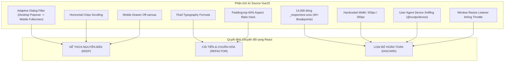

# KẾ HOẠCH LỘ TRÌNH TRIỂN KHAI RESPONSIVE TỪ VUEJS SANG REACT (MIGRATION ROADMAP)

> **Mã tài liệu:** `RMP-REACT-05`  
> **Dự án áp dụng:** `SOURCE_REACT` (`D:\java\JewelryShop_FE\jewelryshop-frontend`)  
> **Tham chiếu nguồn:** `SOURCE_VUE` (`D:\tutor\ihouzz-com`)  
> **Mục tiêu:** Xác định danh mục kế thừa, danh mục cải tiến, danh mục đào thải và thiết lập lộ trình triển khai từng giai đoạn cho đội ngũ kỹ thuật và Coding Agent.

---

## 1. Phân loại Kế thừa Kiến trúc Responsive (Keep / Refactor / Discard)

### 1.1. Những Patterns GIỮ NGUYÊN (KEEP):
1. **Adaptive Filter Interaction:**
   - Trên desktop: Bộ lọc hiển thị dạng dropdown popover tinh gọn.
   - Trên mobile: Tự động chuyển thành Modal / Bottom Sheet toàn màn hình có nút Hủy / Xác nhận lớn ở đáy.
2. **Horizontal Chips Category Bar:**
   - Thanh chọn danh mục cuộn ngang êm ái trên mobile (`overflowX: 'auto', scrollbarWidth: 'none'`), giúp tối ưu diện tích dọc.
3. **Off-Canvas Mobile Navigation:**
   - Menu di động trượt từ cạnh màn hình kèm lớp phủ làm mờ (backdrop overlay), chuyển submenu sang dạng accordion.

### 1.2. Những Patterns CẢI TIẾN & CHUẨN HÓA (REFACTOR):
1. **Fluid Typography:**
   - Chuyển đổi công thức tính toán `calc()` phức tạp của Vue thành hàm chuẩn CSS `clamp(min, preferred, max)` trong `src/theme/typography.ts`.
2. **Image Aspect Ratio:**
   - Thay thế hoàn toàn kỹ thuật hack `padding-top: 60%` và ảnh nền inline `background-image` bằng thuộc tính CSS native `aspectRatio: '4/5'` (cho trang sức) và thẻ `` với `objectFit: 'cover'`, tích hợp `loading="lazy"`.
3. **Layout Container:**
   - Thay thế việc ghi đè CSS class `.container` bằng component `<Container maxWidth="xl">` chuẩn của MUI với padding co giãn theo thang đo 8pt.
4. **Modal Sizing:**
   - Thay thế 4 tầng override `!important` (50% -> 70% -> 90% -> 100%) bằng hook `useMediaQuery(theme.breakpoints.down('sm'))` điều khiển prop `fullScreen` của MUI Dialog.

### 1.3. Những Patterns ĐÀO THẢI TUYỆT ĐỐI (DISCARD):
1. **14,000 dòng SCSS Monolith (`_responsive.scss`):**
   - Không chuyển bất kỳ đoạn CSS `max-width` cũ nào sang React. Toàn bộ responsive được viết bằng cú pháp `sx` Mobile-First của MUI.
2. **40+ Micro-breakpoints tùy tiện:**
   - Xóa bỏ toàn bộ các breakpoint như `1883px`, `1740px`, `1544px`, `544px`, `437px`, `350px`. Quy hoạch dứt khoát về 5 breakpoint chuẩn MUI (`xs`, `sm`, `md`, `lg`, `xl`).
3. **Hardcoded Pixel Widths:**
   - Cấm hoàn toàn các khai báo `width: 500px` hay `width: 350px` trên các phần tử layout hoặc form tìm kiếm.
4. **User-Agent Sniffing (`@nuxtjs/device`):**
   - Loại bỏ việc dựa vào User-Agent để quyết định số lượng cột slider hay hiển thị component. Mọi hành vi layout phải dựa trên kích thước viewport thực tế (CSS Media Queries hoặc `useMediaQuery`).
5. **Window Resize Listener thủ công:**
   - Loại bỏ các hàm `window.addEventListener('resize')` thiếu throttle gây giật lag giao diện.

---

## 2. Thứ tự Triển khai Chi tiết Theo Giai đoạn (5 Phases)

### Giai đoạn 1: Chuẩn hóa Hạ tầng Theme & Layout Nền tảng (Foundation)
- **Ưu tiên:** Cao nhất (P0).
- **Phạm vi file:**
  - `src/theme/index.ts`
  - `src/theme/typography.ts`
  - `src/theme/components.ts`
  - `src/layouts/StorefrontLayout.tsx`
  - `src/layouts/AdminLayout.tsx`
- **Công việc cụ thể:**
  1. Hoàn thiện cấu hình `clamp()` trong `typography.ts` cho `h1`, `h2`, `h3`.
  2. Bổ sung `MuiCssBaseline` với `minHeight: '100dvh'`, hỗ trợ `env(safe-area-inset-*)`.
  3. Kiểm tra Header và Drawer trong `StorefrontLayout.tsx`: đảm bảo chiều cao thích ứng `{ xs: 64, md: 76 }` và Drawer width `min(320px, 85vw)`.
  4. Chuẩn hóa Footer trong StorefrontLayout theo mẫu `ResponsiveFooter` 4 cột co về 1 cột.

### Giai đoạn 2: Danh mục Sản phẩm & Thẻ Trang sức (Catalog & Cards)
- **Ưu tiên:** Rất cao (P0).
- **Phạm vi file:**
  - `src/features/catalog/pages/CatalogPage.tsx`
  - `src/features/catalog/components/ProductCard.tsx`
  - `src/features/catalog/components/CategoryFilter.tsx`
  - `src/features/catalog/components/MiddleBanner.tsx`
- **Công việc cụ thể:**
  1. Cấu hình Grid sản phẩm: 2 cột trên mobile (`xs: 'repeat(2, 1fr)'`), 3 cột trên tablet (`md: 'repeat(3, 1fr)'`), 4 cột trên desktop (`lg: 'repeat(4, 1fr)'`).
  2. Chuẩn hóa thẻ `ProductCard`: kiểm tra `aspectRatio: '4/5'`, `WebkitLineClamp: 2` cho tên sản phẩm, hiển thị giá rõ ràng trên di động.
  3. Thanh tìm kiếm: áp dụng `ResponsiveFilterBar` (co giãn 100%, chip cuộn ngang).

### Giai đoạn 3: Trang Chi tiết & Giỏ hàng (Detail Page & Cart Drawer)
- **Ưu tiên:** Cao (P1).
- **Phạm vi file:**
  - `src/features/catalog/pages/ProductDetailPage.tsx`
  - `src/features/cart/components/CartDrawer.tsx`
  - `src/features/orders/pages/CheckoutPage.tsx`
- **Công việc cụ thể:**
  1. Trang chi tiết sản phẩm: Chuyển đổi từ 1 cột (Mobile) sang 2 cột đối xứng (Ảnh bên trái, Thông số bên phải trên `md+`).
  2. Thư viện ảnh chi tiết (Product Gallery): Hỗ trợ vuốt ngang cảm ứng mượt mà trên điện thoại.
  3. Cart Drawer: Đảm bảo nút "Tiến Hành Đặt Hàng" luôn nổi bật ở đáy màn hình di động, có đệm `env(safe-area-inset-bottom)`.

### Giai đoạn 4: Cổng Quản trị & Bảng Dữ liệu (Admin Portal & Data Tables)
- **Ưu tiên:** Trung bình (P2).
- **Phạm vi file:**
  - `src/features/admin/pages/AdminProductsPage.tsx`
  - `src/features/admin/pages/AdminInventoryPage.tsx`
  - `src/features/admin/pages/AdminOrdersPage.tsx`
- **Công việc cụ thể:**
  1. Bọc toàn bộ các bảng `Table` trong `ResponsiveTableWrapper` có `overflowX: 'auto'` và `minWidth: 700px`.
  2. Tinh chỉnh các Dialog thêm/sửa sản phẩm: `fullScreen` trên `xs`, hộp thoại nổi cân đối trên `sm+`.
  3. Thanh Tabs quản trị: Đảm bảo có `variant="scrollable"` để không bị tràn viền khi xem trên tablet dọc.

### Giai đoạn 5: Kiểm thử Đa Thiết bị & Tối ưu Hiệu năng (QA & Polish)
- **Ưu tiên:** Cao (P1).
- **Công việc cụ thể:**
  1. Chạy toàn bộ 12 kịch bản kích thước trong `RESPONSIVE_TESTING_CHECKLIST.md`.
  2. Kiểm tra lỗi layout shift (CLS): Xác thực toàn bộ skeleton loading khớp 100% với kích thước card thật.
  3. Chạy `npm run typecheck`, `npm run lint`, `npm run test` để đảm bảo không phát sinh bất kỳ lỗi hồi quy (regression) nào.

---

## 3. Quản lý Rủi ro & Giải pháp Phòng ngừa (Risk Register)

| Mã Rủi ro | Mô tả Rủi ro Kỹ thuật | Mức độ | Biện pháp Phòng ngừa & Khắc phục |
|---|---|---|---|---|
| **R-01** | Bảng quản trị bị tràn ngang làm hỏng layout trên điện thoại | Cao | Bắt buộc sử dụng `ResponsiveTableWrapper` với `overflowX: 'auto'` và `WebkitOverflowScrolling: 'touch'`. |
| **R-02** | Tên trang sức quá dài làm lệch chiều cao các card trong hàng | Trung bình | Sử dụng CSS `-webkit-line-clamp: 2` kết hợp `alignItems: 'stretch'` ở cấp độ Grid. |
| **R-03** | Modal checkout bị che khuất nút xác nhận do bàn phím ảo bật lên | Cao | Khống chế `maxHeight: '100dvh'` (Dynamic Viewport Height) cho modal trên di động, tách biệt vùng cuộn nội dung và thanh action cố định ở đáy. |
| **R-04** | Tràn lề ở các điện thoại siêu nhỏ (320px - 360px) | Trung bình | Luôn dùng `min(width, 85vw)` cho các Drawer và thanh trượt; gutters tối thiểu 16px (`px: 2`). |
| **R-05** | Giật lag khi render lại danh sách sản phẩm | Thấp | Tận dụng caching của `@tanstack/react-query`, giữ DOM ổn định, không dùng event listener resize toàn cục. |

---

## 4. Tiêu chí Hoàn thành Tổng thể (Definition of Done - DoD)

Một nhiệm vụ triển khai responsive trên `SOURCE_REACT` được chính thức coi là HOÀN THÀNH (DONE) khi thỏa mãn toàn bộ các điều kiện sau:

- [ ] Toàn bộ code tuân thủ 100% quy chuẩn Mobile-First bằng cú pháp MUI `sx`.
- [ ] Không có bất kỳ file CSS/SCSS nào được tạo thêm chứa `@media (max-width: ...)`.
- [ ] Vượt qua toàn diện 12 kích thước kiểm thử trong `RESPONSIVE_TESTING_CHECKLIST.md`.
- [ ] Không xuất hiện thanh cuộn ngang ở cấp độ `body` trên bất kỳ kích thước nào ($320\text{px} - 2560\text{px}$).
- [ ] Mọi vùng cảm ứng (Touch Target) đều đạt chuẩn tối thiểu $44\text{px} \times 44\text{px}$.
- [ ] Lệnh kiểm tra hệ thống chạy thành công tuyệt đối:
  - `npm run typecheck` $\rightarrow$ 0 error.
  - `npm run lint` $\rightarrow$ 0 warning/error.
  - `npm run test` $\rightarrow$ Toàn bộ test cases passed.

---
*Kế hoạch Lộ trình Triển khai đã sẵn sàng để chuyển giao cho Coding Agent thực thi theo từng giai đoạn.*

